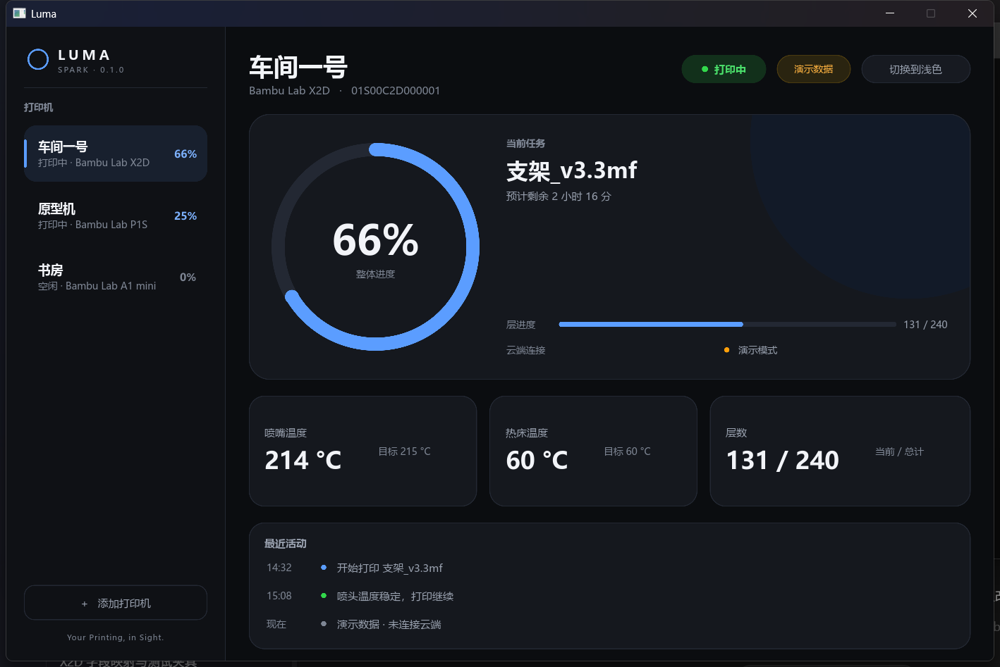
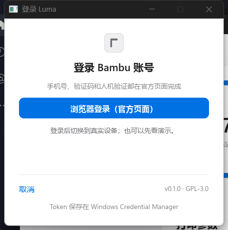
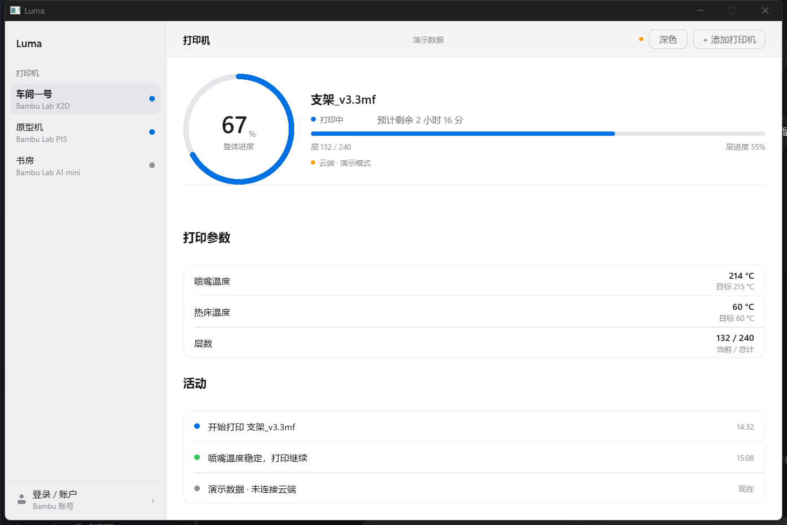

# Luma

**Your Printing, in Sight.**

[](https://github.com/Wildcreator2010/Luma/releases/latest)
[](LICENSE)

面向 3D 打印设备的智能监控软件与独立硬件生态。当前聚焦 Bambu Lab（拓竹）打印机，
第一步为中国大陆云端只读监控，桌面端采用 Rust + Slint，硬件端规划 ESP32-S3 + 墨水屏。

源码：<https://github.com/Wildcreator2010/Luma>



首次启动会打开登录窗口：





## 当前状态

- 版本：`0.1.1`（代号 **Spark**；`0.2.0 Glow` 开发中，未发布）
- 阶段：**Phase 1/2 — 核心模块与云端接入已实现，等待真实账号联调**
- 桌面端：Slint 界面可运行；无 Token 时自动进入**演示模式**，有 Token 时接真实云端
- Windows：原生系统托盘已验证；深色/浅色主题、自定义进度环已验证
- 状态条：可停靠顶部/底部/任务栏并自定义尺寸、透明度与显示内容，
  支持时钟/日期/电池与打印机状态；
  始终鼠标穿透，悬停时淡出隐藏，可用托盘菜单或设置页调整（见 `docs/STATUS_BAR.md`）
- 启动方式：GUI 子系统，双击不会再弹出黑色控制台窗口；任务栏与窗口图标使用内置图标
- 发布形态：提供 **Windows x64 MSI 安装包**与**便携 ZIP**；安装版自带版本资源、
  DPI/长路径清单、静态 CRT（无需 VC++ 运行库）、单实例唤醒、文件日志与崩溃日志
- 云端接入：登录、设备列表、MQTT 订阅、状态投影、自动重连已实现；
  **尚未用真实账号 + 真实 X2D 验证**
- 固件：未开始；ESP32-S3 可行性调研已完成（有条件可行）

> 真实联调前，协议字段仍按公开社区资料实现；详细协议调研属于内部资料，
> 不随公开仓库发布。

## 安装

从 [Releases](https://github.com/Wildcreator2010/Luma/releases/latest) 下载最新版：

```text
Luma-0.1.1-win64.msi              Windows x64 安装包（每用户安装，无需管理员）
Luma-0.1.1-win64-portable.zip     便携版，解压后双击 Luma.exe
SHA256SUMS.txt                    SHA-256 校验值
```

本地构建的产物在 `dist/`：

```text
dist/Luma-0.1.1-win64.msi              Windows x64 安装包（每用户安装，无需管理员）
dist/Luma-0.1.1-win64-portable.zip     便携版，解压后双击 Luma.exe
dist/SHA256SUMS.txt                    SHA-256 校验值
```

安装包会把程序放到 `%LOCALAPPDATA%\Programs\Luma`，创建开始菜单快捷方式、
“应用和功能”卸载项和 `Luma.exe` 的 App Paths 注册项。安装、升级、卸载都不需要
管理员权限；更高版本会通过 Major Upgrade 覆盖安装。

```powershell
# 静默安装 / 静默卸载
msiexec /i .\dist\Luma-0.1.1-win64.msi /qn
msiexec /x .\dist\Luma-0.1.1-win64.msi /qn
```

运行日志在 `%LOCALAPPDATA%\Luma\logs\luma.log`，崩溃现场在 `panic.log`。
卸载不会删除设置、日志和凭据；彻底清理方式见 [安装与发布](docs/INSTALLER.md)。

> 标准版不捆绑摄像头运行库。MSI 安装时会尝试从本机 Bambu Studio 导入
> `BambuSource` / FFmpeg / VC++ Runtime 到 `%LOCALAPPDATA%\Luma\camera`；
> 便携版可手动运行 `Luma.exe --import-camera-runtime`。未安装 Bambu Studio 时
> 只影响实时画面，云端监控、状态条和托盘不受影响。
>
> 如需要“装好即用”的摄像头依赖，可在装有 Bambu Studio 的机器上本地构建全量版：
>
> ```powershell
> .\scripts\build-installer.ps1 -Full
> ```
>
> 产物为 `dist/Luma-0.1.1-win64-full.msi` / `...-full-portable.zip`。
> 全量版包含 BambuSource、live555、FFmpeg、VC++ Runtime 等第三方二进制，
> 受各自许可证约束；未经确认分发权前不应上传到公开下载。

## 构建与运行

环境要求：

- Windows 10/11 x64
- Rust stable ≥ 1.95（MSVC target；Slint 1.19 要求）
- Visual Studio Build Tools（C++ 链接器）

```powershell
cargo test --workspace
cargo run -p luma-desktop
```

首次启动直接弹出登录窗口，**登录方式只有一种：浏览器登录**。

Luma 用独立 profile 启动本机 Edge/Chrome，打开 Bambu 官方登录页。你在官方
页面完成手机号、密码、验证码、扫码或 2FA（含 Geetest 人机验证）后，Luma
通过本地 CDP 抓取 token、校验并自动导入，随后关闭该浏览器窗口。

桌面端不再提供密码框、短信验证码和手动粘贴 accessToken 的入口——这三条
路径在 CN 站点要么被 Geetest 阻断，要么会返回无法区分的错误。

> 端侧短信登录在 CN 不可用：`sendsmscode` 返回 `418` + Geetest，
> 必须由浏览器完成。

Token 存 Windows Credential Manager，登录成功后自动连接云端。
也可以点“先看看演示”直接进入演示界面。

CLI 保留密码登录与抓包，仅用于调试与协议验证：

```powershell
cargo run -q -p luma-cli -- login --account <邮箱或手机号>
```

2FA 账号请用桌面端的浏览器登录，或 CLI `import-token`。

常用命令：

```powershell
cargo run -q -p luma-cli -- status
cargo run -q -p luma-cli -- devices
cargo run -q -p luma-cli -- import-token
cargo run -q -p luma-cli -- capture --seconds 60
cargo run -q -p luma-cli -- logout
```

截图/演示模式：

```powershell
cargo run -p luma-desktop -- --demo
cargo run -p luma-desktop -- --light --demo
cargo run -p luma-desktop -- --complete
```

`--demo` 强制演示模式，`--light` 浅色主题，`--complete` 100% 完成态。

安装版可直接查询版本：

```powershell
& "$env:LOCALAPPDATA\Programs\Luma\Luma.exe" --version
```

### 打包安装包

需要 Rust 工具链、.NET SDK 和 WiX 6（脚本会在缺失时尝试自动安装 WiX）：

```powershell
powershell -ExecutionPolicy Bypass -File .\scripts\build-installer.ps1
```

脚本会构建 release exe、组装 payload、生成便携 ZIP、调用 WiX 生成 MSI，
并输出 SHA-256。详细说明见 [安装与发布](docs/INSTALLER.md)。

### 依赖镜像

本仓库包含 `.cargo/config.toml`，把 crates.io 指向 `rsproxy.cn`。
原因：当前网络访问官方 sparse index 会长时间挂起。删除该文件即可恢复官方源。

## 工作区

```text
crates/
  luma-model/      共享领域模型（桌面 + 固件，只依赖 serde）
  luma-protocol/   Bambu 报文 → PrinterState 投影（X2D）
  luma-core/       状态聚合、多设备管理、Provider 抽象
  luma-cloud/      拓竹云端（登录、Token、MQTT）
  luma-cli/        luma 命令行（登录/状态/抓包）
  luma-storage/    SQLite 持久化
  luma-desktop/    Slint 桌面端
firmware/          ESP32-S3 固件（后续阶段，独立构建）
docs/              架构、数据模型、状态条、安装与品牌
```

## 安全约定

- 不硬编码账号密码。
- 不在日志中输出 Token、密码、Cookie。
- 未验证的 API / Topic / 字段不得进入代码。
- Token 存储使用 Windows Credential Manager（已实现）。

## 许可证

Luma 采用 **GPL-3.0-only**，见 [`LICENSE`](LICENSE)。

Slint 同样以 GPLv3 方式使用，与本项目许可证兼容。

## 文档

- [架构](docs/ARCHITECTURE.md)
- [数据模型](docs/DATA_MODEL.md)
- [状态条](docs/STATUS_BAR.md)
- [品牌](docs/BRAND_IDENTITY.md)
- [安装与发布](docs/INSTALLER.md)

协议调研、账号/Token 流程审计、风险/路线图、UI 迭代记录和整屏截图存档属于
内部资料，不随本仓库发布。

